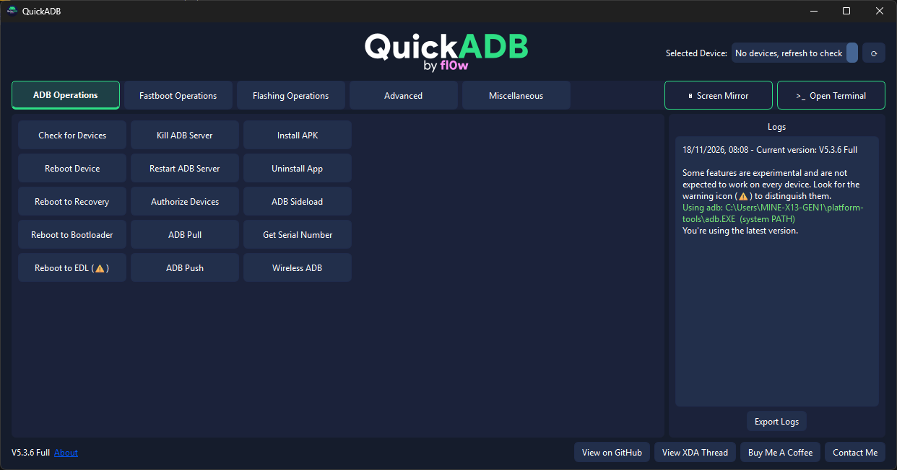
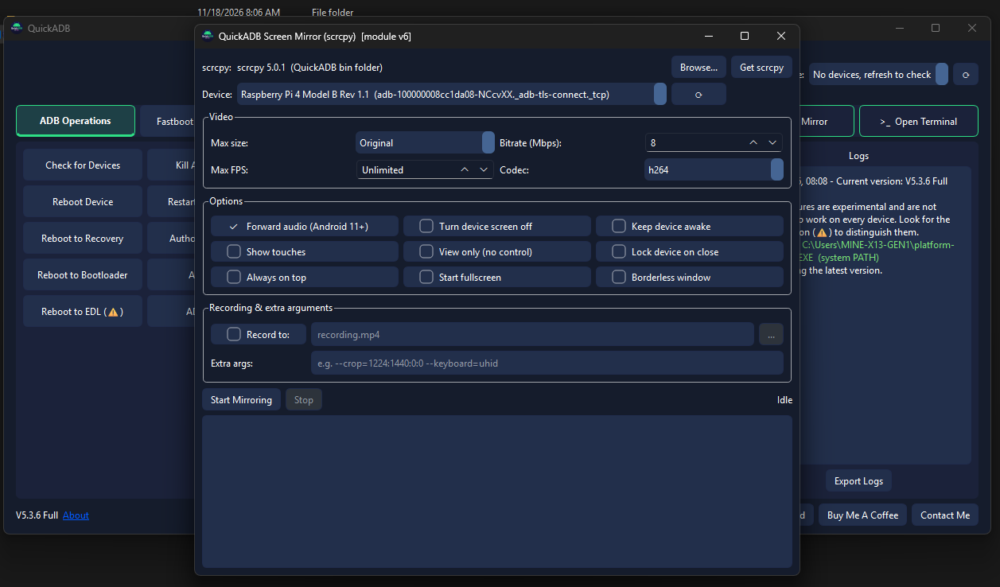

# QuickADB Updates

Unofficial changes to [QuickADB](https://github.com/CodeFl0w/QuickADB) by CodeFl0w. They add **Screen Mirror** (scrcpy), a new way of finding adb that fixes the temp-folder error on exit, and some interface changes.

Built against upstream commit **`01478e1`** ("Move Build log under Improved header"), QuickADB **V5.3.6**.

## Screenshots





## What's in this folder

| File | What it is |
|------|------------|
| `quickadb-updates.zip` | The changed files, ready to copy over a QuickADB folder. Also includes the patch and `HOW-TO-UPDATE.txt`. |
| `quickadb-updates.patch` | The same changes as a git patch, for a fresh clone. |

## Installing

Use **one** of these methods, not both.

### Option 1: Copy the files (works on any copy)

1. Extract `quickadb-updates.zip` into your QuickADB folder, the one that contains `main.py`.
2. Let it overwrite existing files.

This works on a fresh clone and on a copy that already has some of the earlier updates.

### Option 2: Apply the patch (fresh clone only)

From inside the QuickADB folder:

```
git apply --check quickadb-updates.patch
git apply quickadb-updates.patch
```

If `--check` prints errors, that copy has already been changed. Use Option 1 instead.

### Then run it

```
pip install -r requirements.txt
python main.py
```

To check the update worked:
- The main window opens on **ADB Operations**, and that tab is highlighted.
- The log shows a `Using adb: ...` line, or an "adb not found" message.
- The **Screen Mirror** window's title ends in `[module v6]`.

## What changed

### Finding adb

QuickADB used to look for adb only in a `platform-tools` folder bundled with the app. A fresh clone doesn't have that folder, so running from source found no devices and gave no error. In the packaged exe, adb ran from PyInstaller's temporary `_MEI...` folder. The adb server keeps running after QuickADB closes, which locks that folder and causes an error on exit.

adb is now found in this order:

1. **The system PATH.**
2. **The QuickADB folder and up to 4 levels of subfolders.** Folder names don't matter, so `platform-tools\`, `bin\platform-tools\` and `tools\anything\` all work. If there is more than one copy, a folder named `platform-tools` wins, then the one closest to the top.
3. **Not found:** QuickADB offers to download Google's platform-tools into `QuickADB\platform-tools`. It shows a progress bar and starts using the new adb right away, without a restart.

fastboot is taken from the same folder as adb when possible.

Other changes:
- The log says which adb is in use and where it was found.
- **Miscellaneous → Get platform-tools** downloads or re-downloads platform-tools at any time.
- platform-tools is no longer built into the executable, and `build.py` no longer deletes your local `platform-tools` folder.
- Terminal, GSI Flasher, App Manager and Boot Animation Creator use the same lookup.

> If an old adb from another program is on your PATH, it is used before the copy in the QuickADB folder. The `Using adb:` log line shows which one is active.

### Screen Mirror (scrcpy)

A launcher for [scrcpy](https://github.com/Genymobile/scrcpy) that mirrors and controls the selected device from your computer.

- It has its own device list, so it works with several devices connected, including wireless ones.
- It runs scrcpy with the same adb QuickADB uses, so the two don't start competing adb servers.
- **Settings:** max resolution, bitrate, FPS limit, codec, audio, screen off, stay awake, show touches, view-only, lock on close, always on top, fullscreen, borderless, recording to a file, and a field for any extra scrcpy flags.
- **Start / Stop** buttons, plus a log of scrcpy's output.

**Getting scrcpy:** scrcpy isn't included. QuickADB looks for it:
1. Anywhere under `QuickADB\bin`, whatever the folder is called, e.g. `bin\scrcpy-win64-v3.3.4\scrcpy.exe`. If several versions are there, the newest is used.
2. In a location you picked earlier with **Browse...**.
3. On the system PATH.
4. In common install locations: winget, Scoop, Chocolatey, Homebrew, Snap, `~/.local/bin`.

If scrcpy isn't found, the message turns red and the window offers to download it. **Get scrcpy** downloads the latest release for your system from GitHub, checks it against the release's published SHA-256 checksum, and extracts it into `bin`. Copy the whole release folder, not just `scrcpy.exe`, since it needs `scrcpy-server` and the DLLs that come with it.

### Interface

- The window is a little wider (minimum 1240 px).
- **Screen Mirror** and **Open Terminal** are outlined buttons on the right of the tab row, since they open windows rather than switch tabs.
- The current tab is highlighted with a green fill, an outline and a bottom bar, in every built-in theme.
- QuickADB opens on **ADB Operations** instead of an empty panel.

## Files changed

```
main/quickadb.py            main window: adb check, buttons, tab highlight, width
modules/scrcpy.py           new: Screen Mirror window
util/toolpaths.py           new adb / fastboot lookup
util/platformtools.py       new: "adb not found" prompt and platform-tools download
modules/terminal.py         use the shared adb lookup
modules/gsiflasher.py       use the shared adb lookup
modules/appmanager.py       use the shared adb lookup
modules/bootanimcreator.py  look up adb when used, not at startup
build.py                    stop downloading and bundling platform-tools
QuickADB.spec               stop bundling platform-tools
```

## Building

`python build.py` works as before, but the executable no longer contains platform-tools. On first run, the built app uses adb from the PATH or from its own folder, or offers to download it. To ship a ready-to-use copy, put a `platform-tools` folder next to `QuickADB.exe`.

## Known messages

`qt.svg: Invalid path data; path truncated.` at startup comes from the original QuickADB logo file and is harmless. It shows up without these changes too.

## Credits and license

- [QuickADB](https://github.com/CodeFl0w/QuickADB) by CodeFl0w, GPL-3.0. These changes are released under the same license.
- [scrcpy](https://github.com/Genymobile/scrcpy) by Genymobile, downloaded separately.
- [Android SDK Platform-Tools](https://developer.android.com/tools/releases/platform-tools) by Google, downloaded separately.
